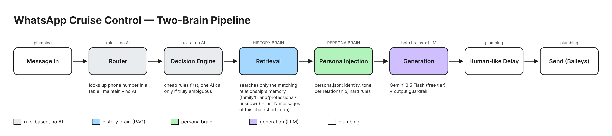
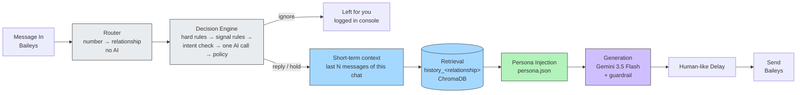

# 💬 Put Your WhatsApp on Cruise Control
### Hands-free replies by an AI agent using RAG

A **retrieval-grounded persona agent**, not a chatbot. A message arrives via Baileys → a rule-based router tags the relationship → a layered engine decides reply-or-ignore → the last N messages of this chat are pulled in as short-term context → RAG retrieves your most similar past replies from that relationship's memory as long-term style → your persona and tone are injected → Gemini writes the reply in your voice → a guardrail checks it → a human-like delay → Baileys sends it. The Cruise Control Console shows every step live.



## Architecture



Gray = rule-based, no AI · Blue = history brain · Green = persona brain · Purple = both brains combine (the AI call) · White = plumbing.

## Repo layout (as in the course)

```
persona/     build_persona.py · persona.json · test_persona.py · style_signals_*.json · sample_outputs.md
ingestion/   parse_export.py · clean_pairs.py · validate_pairs.py · build_relationship_map.py ·
             validate_relationship_map.py · embed_to_chroma.py · retrieval.py · retrieval_demo.py
agent/       router.py · decision_engine.py · context.py · generator.py · guardrail.py · pipeline.py ·
             settings.py · batch_test.py
bridge/      bridge.py            (Flask, 127.0.0.1:5001)
whatsapp/    baileys_client.js    (Baileys 7, Node 20+)
console/     app.py               (Streamlit Cruise Control Console)
config/      contact_relationship_map.json · relationship_map.json · contact_profiles.json ·
             settings.json · constants.py · sensitive.py
scripts/     healthcheck.sh · setup_session_2_2.sh/.ps1 · stop_chroma.sh/.ps1 · run_all.sh · make_diagram.py
docs/        WHY.md · AUDIT.md · GO_LIVE.md · architecture_diagram.* · problem_context.md
tests/       57 pytest tests  ·  whatsapp/test: 6 node tests
```

## Run it, week by week

```bash
python3 -m pip install -r requirements.txt && (cd whatsapp && npm install)
cp .env.example .env                                   # add GEMINI_API_KEY
bash scripts/healthcheck.sh                            # Part 0 readiness check

# Week 1 -- persona
python3 quick_key_test.py
python3 persona/build_persona.py --file "data/raw_export/WhatsApp Chat with Wife.txt" --name "अरूण" --output persona/style_signals_wife.json
python3 -m json.tool persona/persona.json > /dev/null && echo "Valid JSON"
python3 persona/test_persona.py                        # -> persona/sample_outputs.md

# Week 2 -- memory
python3 ingestion/parse_export.py --name "अरूण"        # -> data/processed_pairs.jsonl (+ quarantine)
python3 ingestion/validate_pairs.py
python3 ingestion/build_relationship_map.py && python3 ingestion/validate_relationship_map.py
./scripts/setup_session_2_2.sh                         # chroma run on :8000
python3 ingestion/embed_to_chroma.py
python3 ingestion/retrieval_demo.py                    # Week 2 screenshot

# Week 3 -- router + decision engine
python3 ingestion/validate_phone_relationship_map.py
python3 -m pytest -q
python3 agent/batch_test.py

# Week 4 -- live
./scripts/run_all.sh                                   # bridge + console + Baileys (scan QR with the DEDICATED number)
```

No key or downloads? `LLM_PROVIDER=offline EMBEDDER=hash` runs the whole pipeline with deterministic stand-ins (labelled in every trace).

## Safety defaults
`dry_run: true` · kill switch · money, OTP, ID and serious topics are never auto-answered · plans get a non-committal **hold** · guardrail on every outgoing reply · silent while you're typing in that chat · rate limit and quiet hours · bridge on localhost with a token · private data git-ignored (`data/`, `logs/`, `private/`, `auth_info_baileys/`, `.env`).

Read **[docs/WHY.md](docs/WHY.md)** for why each part exists, **[docs/AUDIT.md](docs/AUDIT.md)** for what was found and fixed, and **[docs/GO_LIVE.md](docs/GO_LIVE.md)** for going live.
